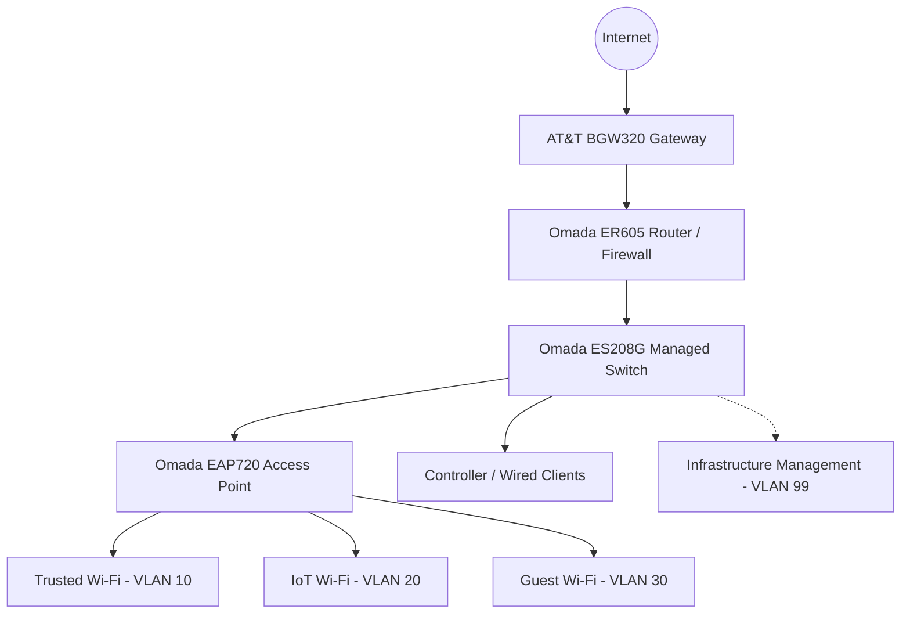

# Home Network Security Lab: VLAN Segmentation \& Firewall Access Control

## Overview

Designed and configured a segmented home network using TP-Link Omada equipment to separate trusted computers, smart-home/IoT devices, guest devices, and network management infrastructure. Implemented inter-VLAN access-control rules, validated connectivity, and troubleshot wireless performance.

> \*\*Portfolio note:\*\* This project documents a real home lab. Device names, credentials, MAC addresses, public IP addresses, and screenshots containing identifying information are intentionally excluded. Private IP ranges are illustrative of the lab configuration.

## Objectives

* Reduce lateral movement opportunities between IoT, guest, and trusted devices.
* Permit trusted devices to access smart-home devices when needed.
* Provide separate guest wireless access.
* Place managed network infrastructure on a dedicated management VLAN.
* Validate addressing, connectivity, and policy behavior with practical tests.

## Equipment and software

|Component|Equipment|
|-|-|
|ISP gateway|AT\&T BGW320|
|Router / firewall|TP-Link Omada ER605 v2.30|
|Managed switch|TP-Link Omada ES208G v1|
|Wireless access point|TP-Link Omada EAP720 (US v1.0)|
|Network management|Omada Software Controller on Windows|
|Test clients|Windows wireless PC and Android phone|

## Logical network design

**Diagram scope:** Logical topology, not a port-by-port wiring diagram. Physical port assignments should be confirmed before publishing a detailed cabling map.

## VLAN and addressing plan

|VLAN|Purpose|Gateway/subnet|DHCP pool|
|-|-|-|-|
|1|Default / legacy management|`Private management subnet (details withheld)`|Not documented|
|10|Trusted devices|`Private /24 subnet`|`DHCP enabled`|
|20|IoT devices|`Private /24 subnet`|`DHCP enabled`|
|30|Guest devices|`Private /24 subnet`|`DHCP enabled`|
|99|Infrastructure management|`Private /24 subnet`|`DHCP enabled`|

Wireless networks mapped to VLANs 10, 20, and 30. The access point was verified on VLAN 99. The controller laptop and some management access remained on the default network during this project.

## Segmentation policy

Seven LAN-to-LAN **deny** rules were configured:

|Source|Destination|Policy|
|-|-|-|
|IoT (20)|Trusted (10)|Deny|
|Guest (30)|Trusted (10)|Deny|
|Guest (30)|IoT (20)|Deny|
|IoT (20)|Management (99)|Deny|
|Guest (30)|Management (99)|Deny|
|IoT (20)|Default (1)|Deny|
|Guest (30)|Default (1)|Deny|

The intended design permits trusted devices to initiate connections to IoT devices, including smart-home equipment. **Important:** The rules above describe configured LAN-to-LAN policy, not a guarantee that every router-local service is protected or that every direction of a stateful session was exhaustively tested.

## Implementation highlights

1. Adopted router, managed switch, and access point into the Omada Software Controller.
2. Created VLAN interfaces and DHCP scopes for Trusted, IoT, Guest, and Management networks.
3. Configured tagged VLAN carriage on relevant switch ports while retaining default untagged connectivity where needed.
4. Created wireless SSIDs mapped to VLANs 10, 20, and 30.
5. Applied seven segmentation deny rules.
6. Verified that the access point received a management-VLAN address.
7. Investigated wireless client band preference and moved a Windows client from 2.4 GHz to 5 GHz.
8. Performed connectivity tests from both trusted and IoT networks.

## Results

|Test|Observation|Interpretation|
|-|-|-|
|Trusted PC DHCP|Client received a valid VLAN 10 address and gateway|Correct VLAN 10 addressing|
|Trusted PC to IoT host|Ping to IoT device: 0% loss|Trusted-to-IoT reachability confirmed for this target|
|Android on IoT to Trusted PC|Ping to Trusted PC: 100% loss|Consistent with intended block; not a standalone proof of ACL enforcement|
|Windows firewall investigation|Private-profile ICMP echo rule inspected; temporary enable and retest still showed 100% loss; rule restored afterward|Increased confidence that the result was network-related, though other filtering remains possible|
|AP management network|Access point received an address on VLAN 99|Management VLAN connectivity verified for AP|
|Wireless link|5 GHz, channel 100, 802.11ac, 780 Mbps negotiated link|Successful move to 5 GHz|
|Internet speed test|581.83 Mbps down / 491.22 Mbps up / 6 ms ping|Strong observed client throughput in one test|

*These are observations from a particular home-lab setup, not guarantees of performance or comprehensive penetration-test results.*

## Troubleshooting example: Wi-Fi performance

A Windows desktop with a Realtek RTL8822CE adapter initially connected to the trusted SSID over 2.4 GHz at a 144.4 Mbps negotiated link rate. After checking the AP's dual-band configuration and changing the adapter's **Preferred Band** setting to **5G first**, the client associated over 5 GHz at 780 Mbps. A subsequent internet speed test measured 581.83 Mbps download and 491.22 Mbps upload.

## Known limitation and next steps

* Router management-plane exposure: During testing, the router's administrative interface remained reachable from the IoT network despite configured LAN-to-LAN deny rules. This indicates that traffic destined for the router's own services requires separate access-control consideration. Remediation has been deferred to avoid disrupting the operational network. Router management access should not be considered fully isolated until additional controls are implemented and validated.
* Review supported controls for router-local management access and restrict administration to authorized networks.
* Validate Guest isolation with documented, repeatable tests and capture sanitized evidence.
* Test policy enforcement with a known listening service rather than relying on ping alone.
* Record firmware versions, backup configuration securely, and establish a maintenance/change log.
* Confirm port-to-device wiring and update a physical topology diagram.

## Skills demonstrated

`VLANs` · `802.1Q` · `Network Segmentation` · `Firewall ACLs` · `DHCP` · `Wi-Fi Troubleshooting` · `TP-Link Omada` · `Windows Networking` · `Security Validation` · `Technical Documentation`

## Documentation

* [Network architecture](docs/architecture.md)
* [Validation and troubleshooting](docs/validation.md)
* [LinkedIn project description](docs/linkedin-project.md)

## Responsible disclosure of lab details

This repository does not contain real passwords, Wi-Fi passphrases, exported device configurations, public-facing addresses, or unsanitized management screenshots. Review any screenshots before publishing to remove MAC addresses, serial numbers, account names, and other identifying information.

